<h1>Week 7 of Helpdesk Exercise</h1>

Helpdesk Simulator: <a href = "https://www.google.com/url?sa=t&rct=j&q=&esrc=s&source=web&cd=&cad=rja&uact=8&ved=2ahUKEwiOiYqVx6eYAxWC1jQHHRAUI1MQFnoECA8QAQ&url=https%3A%2F%2Fsysdesks.com%2F&usg=AOvVaw3JZRWmcdfUv9AB3_rGtlEy&opi=89978449">Source</a>

<h2>Ticket 1</h2>

<strong>Problem Description: </strong>

User Carlos reported that after returning from a three-week leave, he could no longer remember the Windows Hello PIN for his desktop. Although he was able to sign in using his domain password, the system continued defaulting to the PIN prompt whenever the workstation locked, requiring him to manually switch sign-in options. He requested that the old PIN be removed and a new one configured.

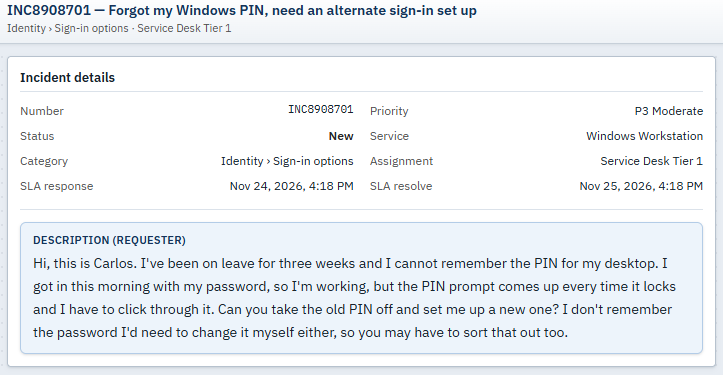
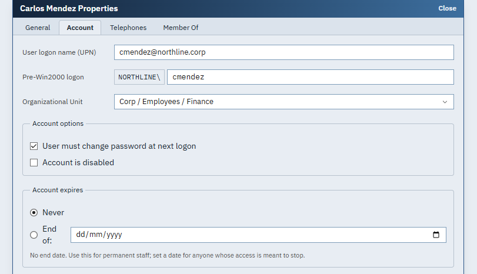
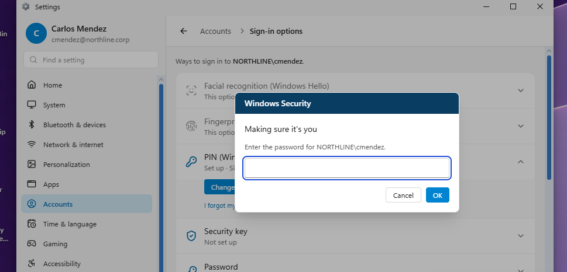

<strong>Steps Taken: </strong>

<ul>
  <li>Navigated to Settings > Accounts > Sign-in options on the user's workstation to reset the Windows Hello PIN, which prompted for the user's current account password to verify authorization.</li>
  <li>Opened Active Directory Users and Computers (ADUC) and performed a temporary password reset on Carlos's account, enabling the option requiring him to set a new password at his next logon.</li>
  <li>Used the temporary password to authenticate in Windows Settings, removed the forgotten PIN, and configured a new temporary PIN.</li>
  <li>Sent the temporary credentials to Carlos via email and advised him to update both his password and PIN upon his next sign-in.</li>
</ul>

<strong>Root Cause: </strong>

The user forgot his local Windows Hello PIN following an extended three-week absence, while Windows remained configured to default to PIN authentication on the lock screen.

<h2>Ticket 2</h2>

<strong>Problem Description: </strong>

HR submitted an offboarding request for departing employee Kai Moreau, whose final shift ends today at 5:00 PM. The request specifies revoking all system and network access upon departure while retaining his mailbox and user files for future handoff.

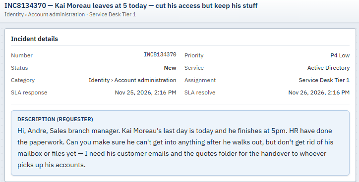
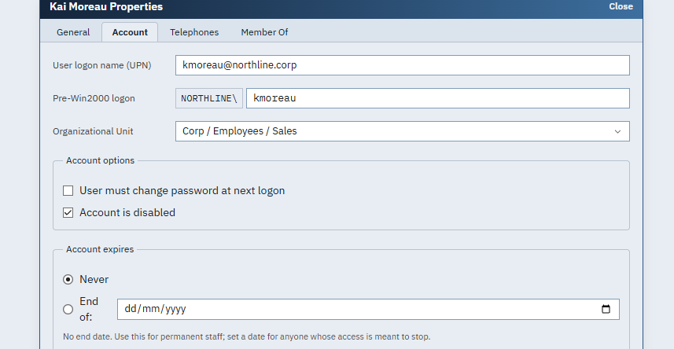

<strong>Steps Taken: </strong>

<ul>
  <li>Located Kai Moreau’s user account in Active Directory Users and Computers (ADUC).</li>
  <li>Disabled the Active Directory account at 5:00 PM to immediately revoke authentication and system access while preserving his user profile, mailbox, and associated files for future transition.</li>
  <li>Verified that the account object was retained in the directory rather than deleted, ensuring data remains accessible for managerial handoff.</li>
</ul>

<h2>Ticket 3</h2>

<strong>Problem Description: </strong>

The main boardroom projector powers on and displays the connected laptop input for approximately 30 seconds before shutting off automatically, accompanied by a flashing red indicator light next to the lamp symbol. Users have already ruled out external input issues by testing two different laptops and swapping the HDMI cable with a known-working one.

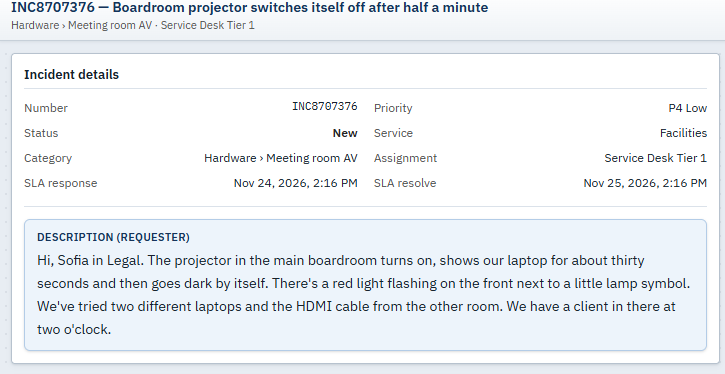
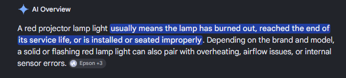

<strong>Steps Taken: </strong>

<ul>
  <li>Reviewed user-performed isolation tests, confirming the issue persists across multiple source laptops and HDMI cables.</li>
  <li>Evaluated hardware symptoms and determined the flashing red lamp indicator indicates a hardware-level fault rather than a software or display configuration issue.</li>
  <li>Escalated the ticket to the Audio-Visual (AV) / Facilities team for on-site hardware inspection, filter cleaning, and potential lamp or thermal unit replacement.</li>
</ul>

<strong>Root Cause: </strong>

Suspected projector hardware fault—specifically thermal overheating (blocked airflow/fan failure) or a failing projector lamp triggering an automatic protective shutdown.

<h2>Ticket 4</h2>

<strong>Problem Description: </strong>

User reported that the Meetly application cannot access their webcam ahead of an upcoming client call, despite the built-in Windows Camera app functioning properly.

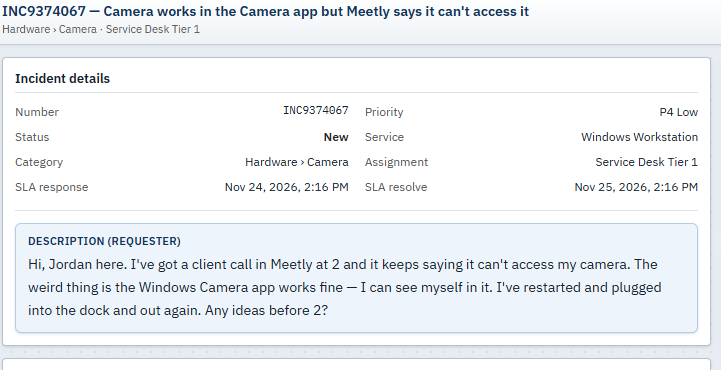
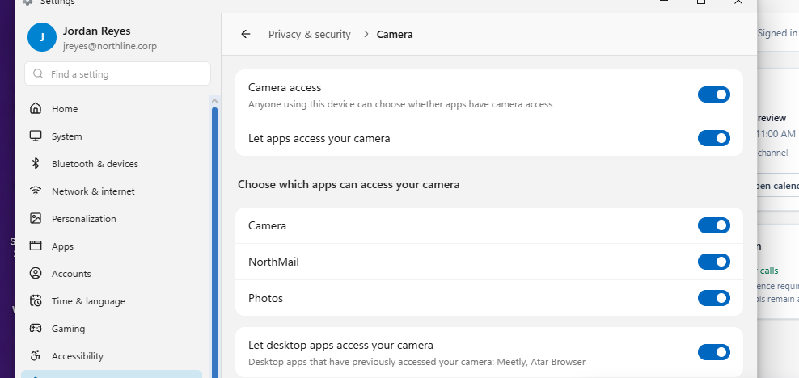

<strong>Steps Taken: </strong>

<ul>
  <li>Verified that the physical camera hardware was functional based on the Windows Camera app test, narrowing the issue down to application-level permissions.</li>
  <li>Navigated to Settings > Privacy & security > Camera on the user's Windows workstation.</li>
  <li>Enabled "Let apps access your camera" (and confirmed desktop/browser access was permitted) so third-party conferencing apps like Meetly can access the video feed.</li>
  <li>Confirmed with the user that Meetly now detects and displays the camera properly.</li>
</ul>

<h2>Ticket 5</h2>

<strong>Problem Description: </strong>

User submitted a request following a security audit notification indicating that her domain account still holds local administrator privileges on her workstation. Temporary admin rights were granted by IT in June to install campaign design software and were not revoked afterward.

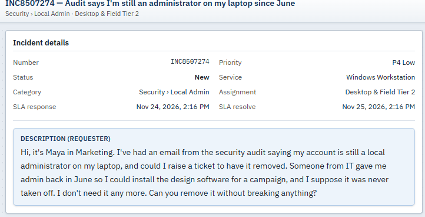
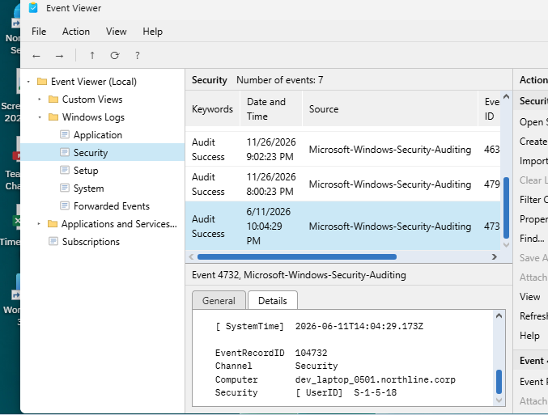
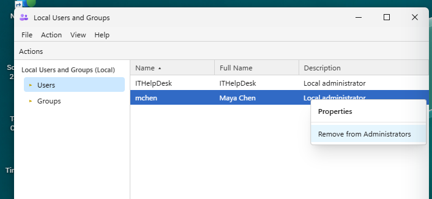

<strong>Steps Taken: </strong>

<ul>
  <li>Opened Event Viewer (eventvwr.msc) on the user's workstation and reviewed the Windows Security logs (specifically Event ID 4732) to identify when the account was added to the local Administrators group and which administrator account authorized the change.</li>
  <li>Opened Computer Management > Local Users and Groups > Groups > Administrators (lusrmgr.msc).</li>
  <li>Located the user's account in the Administrators group membership list and removed it to restore standard user privileges.</li>
  <li>Verified that the user's account no longer appears under the local Administrators group.</li>
</ul>

<strong>Importance of Auditing via Event Viewer </strong>Checking Event Viewer before revoking elevated privileges is a critical security and compliance step for several reasons:

<ul>
  <li>Verifies Legitimate Authorization: Confirms that the privilege escalation was genuinely performed by an authorized IT technician for the stated June software installation, rather than an unauthorized change or compromise.</li>
  <li>Establishes an Audit Trail: Documents the exact timestamp and authorizing technician's account in the ticket notes, providing accountability for the security audit team.</li>
</ul>

<h2>Weekly Key Learnings & Takeaways</h2>
<ul>
  <li>Thorough Ticket Documentation: Recording comprehensive troubleshooting steps, diagnostic findings, and root causes builds a reliable internal knowledge base, allowing future technicians to resolve recurring issues much faster without duplicating effort.</li>
  <li>Proactive User Communication: Providing timely status updates keeps end users informed throughout the resolution or escalation process, reducing follow-up inquiries and building trust in IT support.</li>
  <li>Decisive Triage & Prioritization: Rapidly isolating issues and making timely escalation decisions minimizes downtime, which is especially critical when end users are working under tight project or client deadlines.</li>
</ul>
